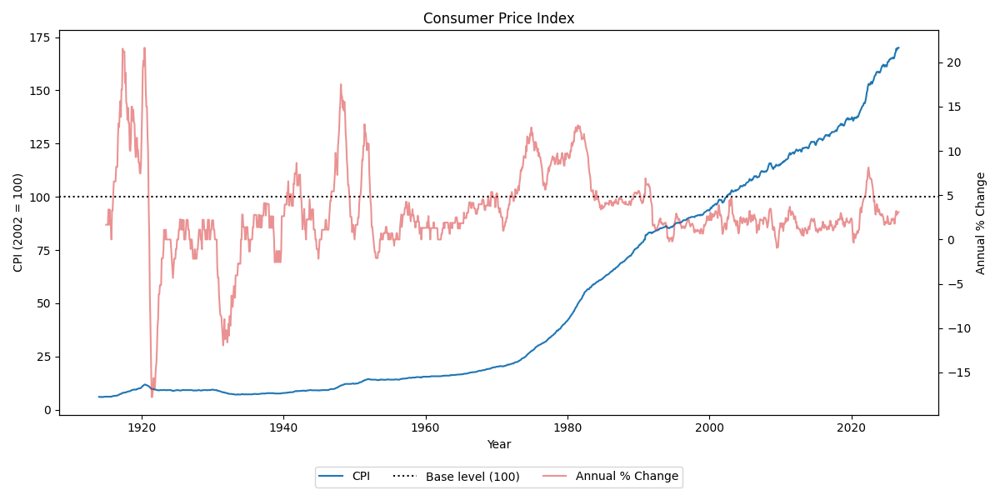

# Assignment-2-Finance-3300
Analyzing Canada's Consumer Price Index (CPI) using Pandas, NumPy, and Matplotlib. The project visualizes historical CPI trends and annual percentage changes through graphs and develops an inflation calculator (Bank of Canada) that allows users to estimate changes in purchasing power and compare prices across different time periods.
The results can be checked against the Bank of Canada's [Inflation Calculator](https://www.bankofcanada.ca/rates/related/inflation-calculator/)

## Files
- `CPI_2.py` - the main program: loads the data, draws the graph, and runs the calculator.
- `cpi_calc.csv` - monthly CPI data, 1914 to present (Bank of Canada Valet API, series STATIC_INFLATIONCALC; 2002 = 100).
- `cpi_graph.png` - the graph produced by the program.

## How to run [Overview of section]
1. Install Python 3 and the required libraries: `pip install pandas matplotlib`
2. Download this repository and keep all files in the same folder.
3. Run `python CPI_2.py`.
4. Enter a price, then a first and second date in `YYYY-MM` format (for example `1914-09`)

## CPI Graph

The blue line is the CPI (left axis, 2002 = 100). The red line is the annual
percentage change (right axis). The dotted line marks the base level of 100.

## Section 1
1. Importing pandas and matplotlib.pyplot
2. Open and read the CSV file by skipping first 8 rows and using datetime to turn data strings into real dates

## Section 3
calculate annual percentage change 

# Sec 4
Plot the graph by creating figure, axes,labels, new Annual change line

### Commentary

The CPI line stays almost flat from 1914 until the early 1970s, and then it starts climbing much faster. It passes the base level of 100 around 2002, which makes sense because 2002 is the base year, and it ends at about 170 in 2026. That means prices today are roughly 70% higher than they were in 2002.

The red line (annual % change) is the most interesting part of the graph. The biggest spike is just after World War I, around 1920, when inflation went above 20%. Right after that, prices fell sharply in 1921, and they fell again in the early 1930s during the Great Depression. There is another spike in the late 1940s after World War II, and then a long stretch of high inflation in the 1970s and early 1980s that peaked at around 13% in 1981.

After the early 1990s, inflation stays low and fairly steady, usually somewhere between 0% and 4%. There are small dips around the 2008-2009 financial crisis and at the start of COVID-19 in 2020. The last big jump is in 2021-2022, when inflation rose to about 8%, the highest in decades. It has come back down to around 3% by 2026

# enhance Calc - perform validation section:
## Price validation – get_price()
Prompt for the price of goods or services.
Remove $ and , so entries like $1,000 are accepted.
Convert the text to a number with float(). If this fails, print an error and ask again.
Check that the price is greater than zero. If not, print an error and ask again.
Return the price once it passes both checks.
## Date validation – get_date(prompt)
Prompt for a date in YYYY-MM format (the function is called twice: first date and second date).
Split the text at - into a year and a month, convert both to whole numbers, and build a date (the 1st of that month). If any step fails (wrong format, letters, month 13), print an error and ask again.
Check that the date is between the first date in the data (1914-01) and the last date (2026-09). If not, print the allowed range and ask again.
Return the date once it passes both checks.

# Section 7: Output the Results

The results are printed in the same layout as the Bank of Canada calculator: dollar amounts with a $ sign, a comma separator, two decimal places (nearest penny) and the CAD currency identifier, followed by the percent change, number of years, average annual rate of inflation, and the CPI of both dates. The graph is then displayed.

## Example 1: matches the Bank of Canada calculator
Inputs: price `100`, first date `1914-09`, second date `2026-09`.

```
$100.00 CAD in September 1914 has the same buying power as $2,833.33 CAD in September 2026.

Percent change:      2733.33%
Number of years:    112.00
Average annual rate of inflation (%)/Decline in the value of money:  3.03%
CPI in September 1914:  6.0
CPI in September 2026:  170.0
```

The Bank of Canada's calculator gives the same result for $100 from 1914 to 2026
(September is the month it uses for both years).

## Example 2
Inputs: price `1000`, first date `2000-09`, second date `2020-09`.

```
$1,000.00 CAD in September 2000 has the same buying power as $1,424.56 CAD in September 2020.

Percent change:      42.46%
Number of years:    20.00
Average annual rate of inflation (%)/Decline in the value of money:  1.79%
CPI in September 2000:  96.1
CPI in September 2020:  136.9

# Section 6 - Look Up the CPI and Calculate
Look up the CPI value for each date entered (cpi1 for the first date, cpi2 for the second date).
Calculate the price in the second period: price2 = price1 × (cpi2 ÷ cpi1). The price changes in proportion to the CPI.
Calculate the percent change: (price2 − price1) ÷ price1 × 100.
Count the months between the two dates and divide by 12 to get the number of years.
Calculate the average annual rate of inflation: ((price2 ÷ price1) ^ (1 ÷ years) − 1) × 100. If both dates are the same month, no time has passed, so the rate is set to 0% (this avoids dividing by zero

